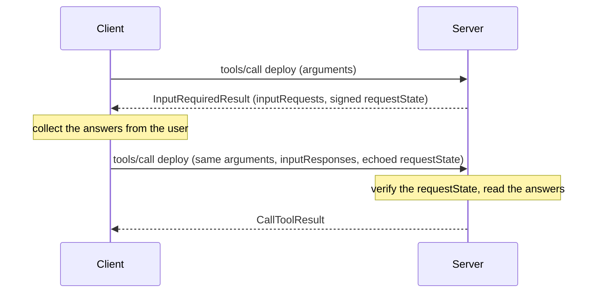

# Asking the client for input

A `tools/call`, `prompts/get`, or `resources/read` handler that cannot finish without something from the client
returns an `InputRequiredResult` instead of its normal result. The client fulfils the requests it names and calls
the same method again, carrying its answers.



```php
$builder->setRequestStateSigner(new RequestStateSigner($secretFromConfig));

$builder->addTool(
    tool: new Tool(name: 'deploy', inputSchema: ['type' => 'object']),
    executor: static function (?array $args, ServerContext $context): CallToolResult|InputRequiredResult {
        $answer = $context->inputResponses['confirm'] ?? null;

        if (! $answer instanceof ElicitResult || ElicitAction::Accept !== $answer->action) {
            return new InputRequiredResult(
                inputRequests: ['confirm' => new ElicitRequest(params: new ElicitRequestFormParams(
                    message: 'Deploy to production?',
                    requestedSchema: new ElicitRequestedSchema(
                        properties: ['ok' => new BooleanSchema()],
                        required: ['ok'],
                    ),
                ))],
                requestState: $context->requestStateSigner?->sign('awaiting-confirmation'),
            );
        }

        return new CallToolResult(content: [new TextContent(text: 'Deployed.')]);
    },
)
```

Four constraints apply to a handler.

## The client resends only the newest round's answers

Anything learned by an earlier round has to travel in `requestState`. That is why a multi-round handler reads its
position from the state, not from an accumulated `inputResponses` map.

## `requestState` is opaque to the client and attacker-controlled on arrival

The spec has the client echo the state back untouched, so a hostile client may echo back something else entirely.
Give the builder a `RequestStateSigner` and the server verifies every echoed state before the handler runs:

```php
use Nexus\Mcp\Server\RequestStateSigner;

$server = (new ServerBuilder())
    ->setRequestStateSigner(new RequestStateSigner($secret))
    // ...
```

A handler then mints through the signer on its context and reads the verified payload back, with no check of
its own:

```php
// Minting, when the handler asks for input.
$state = $context->requestStateSigner?->sign('awaiting-confirmation');

// When the call comes back. A null payload is a first call.
if (null === $context->requestStatePayload) {
    // ask
}
```

A state that fails verification is answered `-32602` with the fixed message `Invalid or expired "requestState"`,
and the reason goes to the logger as a warning. The handler never sees it. Without a signer, `requestState`
reaches the handler as the raw string, `requestStatePayload` stays `null`, and the integrity check is the
handler's own.

`RequestStateSigner::generate()` draws a key for a server whose states never outlive its own process. Anything
longer-lived wants a key from configuration, so a state survives a restart or a second instance behind a load
balancer.

## What the signature covers

The signature folds in three things beyond the payload, which are the spec's own replay checks:

- **The binding.** By default the authenticated subject and client, the method, the tool name, prompt name or
  resource URI it targets, and a digest of its arguments. A state minted for one call verifies on no other tool,
  for no other caller or client, and with no other arguments, so a confirmation obtained for `{target: staging}`
  cannot resume the tool with `{target: production}`. Both are empty over stdio and on an unprotected endpoint,
  and each is empty for an accepted token that names no subject or client, so an endpoint serving more than one
  caller has no caller binding until something authenticates them. A validator accepting tokens from more than
  one issuer should add the issuer through `bindBy()`.
- **An expiry.** Ten minutes by default, set per signer with `ttlSeconds`. A state echoed after it is refused.
- **The secret.** A state minted by another server, or by this one under another key, is refused.

`bindBy()` replaces the default binding with a closure over the request and its `ReceiveContext`, for a
deployment that identifies callers another way:

```php
use Nexus\Mcp\Core\Schema\JsonRpc\JsonRpcRequest;
use Nexus\Mcp\Core\Transport\ReceiveContext;

$signer = (new RequestStateSigner($secret))->bindBy(
    static fn(JsonRpcRequest $request, ReceiveContext $receiveContext): string => $receiveContext->authInfo?->clientId ?? '',
);
```

The payload is signed, not encrypted, and travels in the clear. Put a continuation marker in it, never a secret.
A binding stops another caller replaying a state and the expiry bounds how long. Neither stops the same caller
replaying it inside the window, so a state that must be consumed once needs that enforced server-side.

`RequestStateSigner::deriveBinding()` is the default policy, so a `bindBy()` closure can extend it rather than
replace it. The server applies the policy through `bindFor()`, and `bindTo()` fixes a binding on a signer
outright. `sign()` and `verify()` also take an explicit binding, which overrides the bound one for that call.

With a signer configured, the server verifies every echoed state under the policy and refuses an outgoing one
that does not verify under it, so a handler cannot mint under a binding of its own. Change what the server
binds to with `bindBy()`. The explicit arguments serve a server that has no signer configured and checks its
states by hand.

## Only elicitation is available to ask for

The spec's `InputRequest` union also admits `sampling/createMessage` and `roots/list`. Both are deprecated as of
2026-07-28 (SEP-2577), and this SDK does not model them. `ElicitRequest` is the only thing that a handler can put
in `inputRequests`.

## The field vocabulary

`ElicitRequestedSchema` describes a flat form. Each property is one of the primitive field schemas. Every one
carries an optional `title`, `description`, and `default`, which the client applies when the user leaves the field
alone:

```php
use Nexus\Mcp\Core\Schema\Elicitation\NumberSchema;
use Nexus\Mcp\Core\Schema\Elicitation\StringSchema;
use Nexus\Mcp\Core\Schema\Elicitation\UntitledSingleSelectEnumSchema;

new ElicitRequestedSchema(
    properties: [
        'environment' => new UntitledSingleSelectEnumSchema(
            enum: ['staging', 'production'],
            default: 'staging',
        ),
        'replicas' => new NumberSchema(type: 'integer', minimum: 1, maximum: 12, default: 2),
        'reason' => new StringSchema(maxLength: 200),
    ],
    required: ['environment'],
)
```

`StringSchema` constrains by `minLength`, `maxLength`, and `format`. `NumberSchema` constrains by `minimum` and
`maximum`, and takes `type: 'integer'` for whole numbers. `BooleanSchema` is the yes/no field. Choice fields come
in single-select and multi-select variants, untitled (the value list is what the user sees) and titled (each value
pairs with a display label through `EnumOption`). Nested objects are not part of the vocabulary. Clients render
flat forms.

The answers come back untyped. A client that conforms to the spec applies the defaults and honours the
constraints, but the handler still owns the trust boundary. Read each field from `$context->inputResponses`
defensively, as the example above does with `$answer instanceof ElicitResult`.

## URL mode

A form is one of two elicitation modes. `ElicitRequestUrlParams` instead sends the user to a URL named by the
server, such as a checkout page or a device-authorization screen. The client answers once the visit is done:

```php
use Nexus\Mcp\Core\Schema\RequestParams\ElicitRequestUrlParams;

new ElicitRequest(params: new ElicitRequestUrlParams(
    message: 'Complete the payment to continue.',
    mode: 'url',
    url: 'https://pay.example.com/session/8f3a',
))
```

A client declares which modes it supports under its `elicitation` capability: `form`, `url`, or both. The
request's `_meta` carries that declaration per request, so check `$context->meta->clientCapabilities->elicitation`
before you choose a mode.

[`examples/input-required.php`](../../examples/input-required.php) runs the round trip in one process.
[`conformance/MultiRoundServer.php`](../../conformance/MultiRoundServer.php) is the fuller worked example. It
covers a single round, a signed continuation token, a two-question sequence, and the same flow on a prompt. Both
run unauthenticated, so they sign unbound. There is no caller identity there to bind to.
